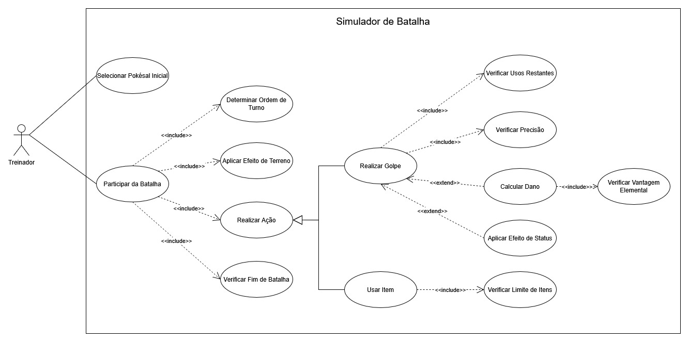

# Pokésal — Simulador de Batalha

Este é um projeto acadêmico desenvolvido em Java para colocar em prática orientação a objetos, modelagem UML, regras de negócio e testes e qualidade de software. A partida acontece pelo console, com os dois jogadores usando o mesmo terminal.

# Link Video Explicativo
https://youtu.be/_2LNdvr_v-I

## Como funciona a partida

O menu permite jogar uma **batalha avulsa** ou um **torneio eliminatório com 4 ou 8 treinadores**. Cada treinador informa seu nome e escolhe **um único Pokésal**. Depois, os jogadores escolhem o clima e o terreno da arena. A cada ação, é possível atacar ou usar um item da mochila. A partida termina quando um dos Pokésal fica sem HP.

Na Fase 03, cada golpe usa precisão de **0 a 100** e tem **6,25% de chance de crítico**, que multiplica o dano por **1,5**. Um erro causa dano zero e continua consumindo um uso. Os resultados são acrescentados a `resultados.csv`; se a gravação falhar, o erro é registrado e o torneio continua. Ao final, o console mostra o campeão e o ranking por vitórias.

As regras adotadas para clima, horário, desempates, recuperação entre rodadas e registro estão em [Fase 03 — implementação e validação](Simulador-de-Batalha-PokeSal-main/docs/FASE-03.md).

## Executar e testar

O comando `verify` também gera o JaCoCo e exige, em cada classe de negócio,
80% de linhas e 70% de branches. A execução atual tem **81 testes aprovados**,
**95,90% de linhas** e **85,71% de branches** no conjunto das regras de negócio.
O [relatório JaCoCo incluído no repositório](Simulador-de-Batalha-PokeSal-main/docs/testes/jacoco-fase03/index.html)
permite consultar cada classe.

Os seis iniciais estão divididos em dois grupos:

| Grupo | Planta | Fogo | Água |
| --- | --- | --- | --- |
| 1 | BulbaSal | CharSal | SquirtSal |
| 2 | ChikoSal | CyndaSal | TotoSal |

Cada Pokésal tem HP (vida), ATK (ataque), DEF (defesa), SPD (velocidade) e um tipo elemental.

### Vantagens elementais

O tipo do golpe é comparado com o tipo do defensor para definir o multiplicador de dano:

| Tipo do golpe | Contra Fogo | Contra Água | Contra Planta |
| --- | ---: | ---: | ---: |
| Fogo | ×1,0 | ×0,5 | ×2,0 |
| Água | ×2,0 | ×1,0 | ×0,5 |
| Planta | ×0,5 | ×2,0 | ×1,0 |

### O terreno também conta

| Arena | Efeito |
| --- | --- |
| Asfalto Quente | Com sol, das 06h (inclusive) às 18h (exclusive), golpes de Fogo causam 15% a mais de dano. |
| Poça de Chuva / Piso Escorregadio | Com chuva, golpes de Água causam 10% a mais de dano. |
| Canteiro Central | Pokésal de Planta recuperam 5% do HP máximo ao final do turno. |

Para a Poça de Chuva, escolhemos implementar o bônus no **dano**, uma das opções previstas no enunciado. A cura respeita o HP máximo e não recupera um Pokésal já derrotado.

O `ServicoTerreno` consulta clima e horário a cada efeito. No console, o clima é escolhido no início e o relógio usa o fuso `America/Bahia`. Nos testes, ambos são controlados por dependências injetadas.

### Turnos e efeitos de status

Quem tiver a maior velocidade efetiva age primeiro. Se as velocidades forem iguais, o desempate é aleatório. Se um Pokésal for derrotado durante uma ação, a batalha termina sem esperar o restante do turno.

Os golpes também podem aplicar efeitos de status:

- **Queimado:** reduz o ataque pela metade e causa dano ao final do turno.
- **Envenenado:** causa dano ao final do turno. 
- **Paralisado:** reduz a velocidade pela metade, influenciando a ordem das ações.

Enquanto a batalha continuar, os efeitos de terreno e o dano de status são aplicados ao final de cada turno.

### Mochila

Cada treinador começa com uma Potion, uma Super Potion e um Antidote. As poções recuperam, respectivamente, 20 e 40 pontos de HP; o Antidote remove o status aplicado ao Pokésal.

O limite é de **dois itens por treinador em cada batalha**. Usar um item ocupa a ação daquele treinador no turno, e o item utilizado é retirado da mochila.

## Os três requisitos criados pela equipe nas fases anteriores

Além das regras propostas para o trabalho, acrescentamos:

1. **Até quatro golpes por Pokésal.** Cada inicial já começa com quatro opções de ataque.
2. **Precisão importa.** Se um golpe falhar no teste de precisão, ele não causa dano.
3. **Golpes têm usos limitados.** Cada golpe possui uma quantidade máxima de utilizações. Uma tentativa consome um uso mesmo quando erra, e golpes esgotados não podem ser escolhidos.

## Os dois requisitos autorais novos da Fase 03

1. **Pontuação por vitória:** 100 pontos ao vencedor, mais 50 se vencer em até três
   turnos. A carteira acumula os pontos da sessão e o console mostra os saldos.
2. **Aviso do resultado:** vencedor e perdedor recebem avisos individuais ao final.
   A falha em um envio não impede o outro nem invalida a batalha.

As regras dependem de `CarteiraPontos` e `NotificadorResultado`, respectivamente,
ambos injetados e mockados nos testes. Veja as condições, os oito testes obrigatórios,
os testes autorais e todos os recursos Mockito na
[validação das etapas 4.2–4.4](Simulador-de-Batalha-PokeSal-main/docs/testes/FASE-03-MOCKITO-JACOCO.md).

## Organização do código

Os pacotes ficam em `Simulador-de-Batalha-PokeSal-main/src/br/edu/ucsal/pokesal`:

| Pacote | Responsabilidade |
| --- | --- |
| `app` | Entrada do programa, cadastro dos treinadores e escolhas iniciais. |
| `arena` | Terrenos e seus efeitos na batalha. |
| `batalha` | Ordem dos turnos, ações, cálculo de dano e resultado da partida. |
| `enums` | Tipos elementais, terrenos e status. |
| `item` | Itens de cura e remoção de status. |
| `pokesal` | Atributos dos Pokésal, golpes e efeitos de status. |
| `treinador` | Treinadores e suas mochilas. |
| `aleatorio` | Interface da fonte de aleatoriedade. |
| `resultado` | Resultado imutável e interface de persistência. |
| `infraestrutura` | Gravação em CSV e registro de eventos no console. |
| `torneio` | Chaves eliminatórias, classificação e fábrica injetável de batalhas. |

## Diagramas

### Casos de uso

### Classes

## Qualidade do código

### Relatório de testes, rastreabilidade, mocks e registro de bugs

- [Matriz de rastreabilidade e justificativa de mocks (4.6)](Simulador-de-Batalha-PokeSal-main/docs/testes/MATRIZ-RASTREABILIDADE.md):
  
- [Documento de testes e registro de bugs (4.6)](Simulador-de-Batalha-PokeSal-main/docs/testes/RELATORIO-TESTES.md):
  
- [Etapas 4.2–4.4 da Fase 03](Simulador-de-Batalha-PokeSal-main/docs/testes/FASE-03-MOCKITO-JACOCO.md):
  
- [Validação inicial da Fase 03](Simulador-de-Batalha-PokeSal-main/docs/FASE-03.md):
  

### SonarQube comparativo e Integração Contínua (4.5)

O [relatório comparativo do SonarQube](Simulador-de-Batalha-PokeSal-main/docs/sonarqube/RELATORIO.md) apresenta a comparação entre a **Fase 02** e a **Fase 03** no SonarQube.

O pipeline de Integração Contínua está em [`.github/workflows/ci.yml`](.github/workflows/ci.yml), executando automaticamente build em JDK 21, suíte JUnit 5 + Mockito, verificação das metas por classe do JaCoCo e publicação dos artefatos a cada `push` ou `pull_request`. 

### Práticas adotadas

O código segue estas práticas:

- **Naming Conventions:** métodos e variáveis em `camelCase`, classes e enums em `PascalCase`
  e constantes em `UPPER_CASE`.
- **Javadoc:** documentação nas classes, enums, construtores e métodos públicos, incluindo
  getters, setters e métodos sobrescritos.
- **Valores fixos nomeados:** constantes para dano-base mínimo, poderes e parâmetros dos golpes,
  cura dos itens, multiplicadores de vantagem e efeitos de terreno e status.
- **Formatação:** linhas de até **100 caracteres** nos arquivos Java e recuo de **2 espaços**,
  sem tabulações na indentação.

Os 14 arquivos Java foram revisados com **Checkstyle 14.1.0**, usando **Google Checks**, sem avisos ou erros.
