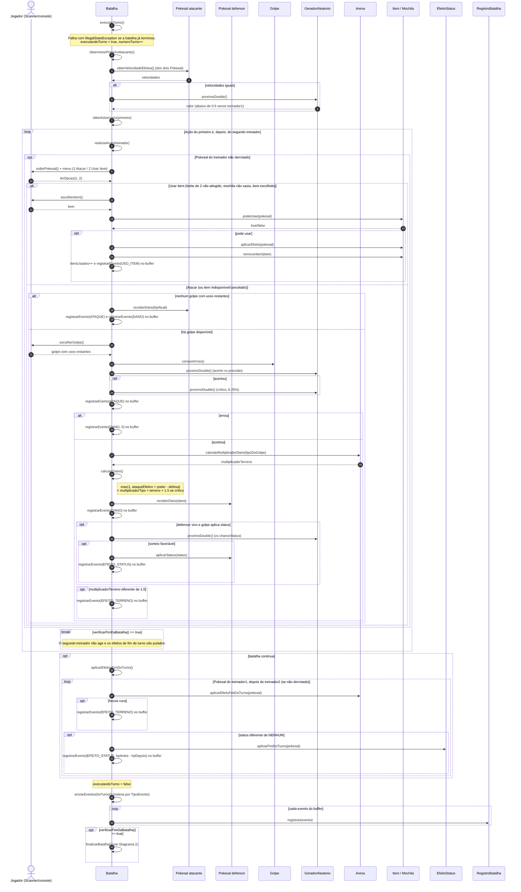
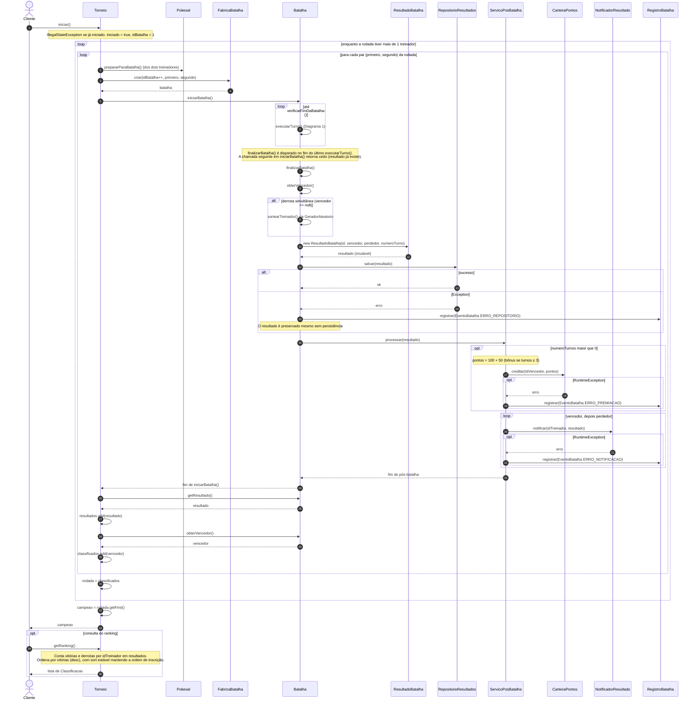

# Diagramas de Sequência — Simulador de Batalha PokéSal

Baseados em `Batalha.java`, `Torneio.java` e `ServicoPosBatalha.java`.

---

## Diagrama 1 — Turno completo de batalha (`Batalha.executarTurno()`)

---

## Diagrama 2 — Registro do resultado no torneio (`Torneio.iniciar()`)

> [!NOTE]
> Falhas em `RepositorioResultados`, `CarteiraPontos` e `ConsoleResultadoTorneio` são isoladas: viram eventos no `RegistroBatalha` e **não** alteram o vencedor nem interrompem o torneio.
